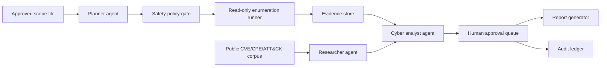

# DLA26BZ02-NV005 - Sigilix CyberRange Agents Proposal Scope

Date: 2026-05-10 America/Los_Angeles
Status: Standalone proposal-scope draft for Arc & Anchor-only pursuit
Product framing: Sigilix CyberRange Agents
Topic: DLA26BZ02-NV005, "Strengthening Defensive Cybersecurity and Penetration Testing Through Agentic AI and Automation"
Working posture: Arc & Anchor-only SBIR pursuit using synthetic/public lab targets only

## Executive Recommendation

Recommendation: pursue only if `DLA26BZ02-NV006` does not consume all proposal bandwidth, or if the team decides to submit two Sigilix proposals. This is a strong Sigilix technical fit, but it is more sensitive than RMF Preflight because cyber automation can be read as risky if the safety boundary is weak.

Arc & Anchor-only likelihood score: `5.5 / 10`.

Planning estimate:

- Technical fit: `7.5 / 10`.
- Arc & Anchor-only proposal viability: `6.5 / 10`.
- Competitive Phase I proposal probability if a credible controlled demo is built: `40-55%`.
- Rough award odds: `20-35%`.

Why: the topic asks for a multi-agent defensive cybersecurity framework with project-management, cyber-analysis, code/execution, and vulnerability-research agents. Sigilix already has multi-agent orchestration, structured findings, security evidence channels, queue-based execution, retrieval, and human review loops. The gap is not agent orchestration; the gap is proving safe, bounded, defensive cyber operations without overclaiming offensive capability.

## DSIP Identifiers And Links

| Field | Value |
| --- | --- |
| Topic code | [`DLA26BZ02-NV005`](https://www.dodsbirsttr.mil/topics/api/public/topics/5bb21baa34404ed48f3488c1d90b3dee_86495/details) |
| Topic title | Strengthening Defensive Cybersecurity and Penetration Testing Through Agentic AI and Automation |
| Topic/application topicId | `5bb21baa34404ed48f3488c1d90b3dee_86495` |
| Topic details API | <https://www.dodsbirsttr.mil/topics/api/public/topics/5bb21baa34404ed48f3488c1d90b3dee_86495/details> |
| DSIP topics app | <https://www.dodsbirsttr.mil/topics-app/> |
| DLA instructions | <https://www.dodsbirsttr.mil/submissions/api/public/download?uploadId=1736714> |
| Local source PDF attachment | [DLA26BZ02-NV005_DLA_SBIR_26.BZ_R2.pdf](source-pdfs/DLA26BZ02-NV005_DLA_SBIR_26.BZ_R2.pdf) |
| Local extracted DLA source | `/tmp/DLA_SBIR_26.BZ_R2.txt` |

## Funding, Dates, And Constraints

| Item | Current planning value |
| --- | --- |
| Program | SBIR |
| Status in scan | Pre-release |
| Open date | 2026-05-27 |
| Q&A close | 2026-06-10 |
| Close date | 2026-06-24 |
| Phase I cap | Not to exceed 12 months and $100,000 |
| Phase II cap | Not to exceed 24 months and $1,000,000 |
| Phase III | No SBIR funding cap stated; DLA Phase III proposal submissions go directly to DLA SBIR2 |
| Contract shape | DLA Phase I is typically Firm-Fixed-Price; Phase II is typically FFP/Level-of-Effort |
| CMMC | Projected CMMC Level 2 (Self) |
| ITAR/EAR | Topic may be restricted under ITAR and/or EAR; foreign nationals may be restricted |
| Proposal posture | Unclassified only; no real DLA networks, no customer systems, no CUI, no export-controlled technical data in demo |

Immediate constraint conclusion:

- Phase 0 and proposal screenshots must use intentionally vulnerable local lab services or synthetic scan data only.
- The proposal should describe human-on-the-loop defensive assessment, not autonomous exploitation.
- Any active validation beyond read-only enumeration should require explicit human approval and stay inside a containerized lab.
- The strongest Phase I story is proof of concept for network enumeration plus RAG-based vulnerability research, because that is exactly what the topic names.

## What DLA Is Asking For

DLA wants an agentic AI framework that can strengthen defensive cybersecurity and automate parts of penetration testing and vulnerability assessment. The topic calls out these agent roles:

- Project Management: plan security tasks such as network enumeration or vulnerability assessment.
- Cyber Analysis: interpret scans and tests, identify defensive actions, and prioritize vulnerabilities.
- Code Generation and Execution: translate high-level plans into executable instructions in emulated environments.
- Vulnerability Research: use RAG against CVEs, CPEs, and technical documentation.

Phase I is specifically about a proof-of-concept workflow for automated network enumeration and a prototype Researcher agent for public CVE research. Phase II expands to richer tasks, including vulnerability validation and human-operator oversight.

Best interpretation: DLA wants a controlled cyber workbench that makes defensive assessments more scalable, auditable, and repeatable. It is not asking for a free-roaming hacking agent.

## Product Thesis

`Sigilix CyberRange Agents` is a controlled, human-supervised agentic cybersecurity framework for defensive assessment in isolated lab and approved enterprise environments.

One-line positioning:

> Sigilix CyberRange Agents coordinates specialized defensive agents to plan, enumerate, research, explain, and report cybersecurity findings inside approved scopes, with strict allowlists, human approval gates, and auditable evidence trails.

Core boundaries:

- No autonomous actions outside an approved target scope.
- No real customer network scanning in Phase 0.
- No exploit execution by default.
- No persistence, evasion, credential theft, lateral movement, or destructive activity.
- No weaponized output in proposal materials.
- No findings are treated as validated until a human reviewer attests them.

## Why Sigilix Fits

| DLA need | Sigilix production evidence to cite | Proposal framing |
| --- | --- | --- |
| Multi-agent cybersecurity workflow | Specialist reviewer agents and synthesis workflow | Reuse agent orchestration for planner, enumerator, researcher, analyst, and reporter roles |
| Structured findings | JSON verdicts, inline comments, confidence, categories | Cyber findings become structured objects with evidence, confidence, scope, and recommended defensive action |
| Security evidence channels | Secret scanning, dependency vulnerability evidence, SARIF ingestion, AST rules | Sigilix already separates deterministic security evidence from LLM narrative |
| Retrieval | Repository retrieval and indexed context | RAG can support CVE, CPE, MITRE ATT&CK, NVD, and vendor-advisory research |
| Queue-based execution | Cloudflare queues, Durable Object state, dedupe | Long-running assessment jobs can be stateful, resumable, and auditable |
| Human oversight | Review/comment loop and explicit human feedback | CyberRange Agents can require human approval before active validation |
| Auditability | Run IDs, status state, markers, logs | Every plan, command proposal, execution event, and finding can be recorded |
| Production maturity | Existing GitHub/Linear automation and passing build | Proposal is an extension of production AI workflow software, not a blank concept |

Strong proposal language:

- "Sigilix has production evidence for orchestrating specialist agents over technical artifacts."
- "Phase I adapts this pattern into a controlled defensive cyber assessment workflow."
- "The framework is defensive, scoped, logged, and human supervised by design."

Avoid:

- "Autonomous hacking."
- "Exploit any target."
- "Fully automated penetration testing."
- "Replace red teams."
- "Self-directed offensive operations."

## Demo Architecture And Data Plan

Use synthetic/public lab targets only:

- OWASP Juice Shop for web vulnerability examples.
- DVWA or WebGoat for training-style web findings.
- Metasploitable or intentionally vulnerable local containers only if licensing and security isolation are acceptable.
- Custom tiny services with seeded misconfigurations for clearer, safer demonstrations.
- Public CVE/NVD data and MITRE ATT&CK references for research.
- Synthetic scan outputs if running tools is too risky for the proposal demo.

No Phase 0 demo should touch:

- DLA systems.
- Corporate networks.
- Internet targets.
- CUI or export-controlled data.
- Real credentials or secrets.
- Real exploit chains.

### Proposed Components

Core data objects:

- Scope file: allowed hosts, ports, tools, time windows, and prohibited actions.
- Plan: agent-proposed steps with risk class and required approvals.
- Command proposal: executable instruction, expected output, safety classification, and approval state.
- Evidence item: source, timestamp, tool, target, normalized output, hash, and redaction status.
- Finding: title, affected asset, evidence link, CWE/CVE/CPE references if applicable, severity, confidence, defensive recommendation.
- Attestation: human reviewer, decision, timestamp, comment, and export eligibility.

## Open-Source Implementation Stack

| Need | Candidate tools | How it helps |
| --- | --- | --- |
| Cyber knowledge base | MITRE ATT&CK, NVD JSON feeds, CVE, CPE dictionary, CWE | Grounds the Researcher agent in public, defensible references |
| Lab targets | OWASP Juice Shop, WebGoat, DVWA, intentionally vulnerable toy services | Provides safe, local, public targets for screenshots and evaluation |
| Enumeration | Nmap with strict allowlists and local-only targets | Satisfies the Phase I network-enumeration proof without touching real networks |
| Vulnerability scanning | Greenbone/OpenVAS as Phase I/II optional adapter | Useful later if bounded; keep optional to reduce setup burden |
| Network telemetry | Zeek, Suricata, Wazuh as Phase II integrations | Supports defensive evidence and monitoring scenarios |
| Agent orchestration | Existing Sigilix worker/agent patterns, LangGraph optional | Reuses existing architecture; avoid unnecessary new orchestration if Sigilix patterns are enough |
| Retrieval | pgvector, Qdrant, LanceDB, or Cloudflare Vectorize | Stores CVE/ATT&CK/vendor docs for RAG |
| Structured outputs | Zod or JSON Schema | Validates plans, findings, approvals, and report exports |
| Evaluation | Pytest/Vitest, Ragas, promptfoo, inspect-ai | Measures retrieval faithfulness, command policy compliance, and seeded finding detection |
| Sandboxing | Docker Compose, rootless containers, read-only mounts | Keeps demo execution isolated and reproducible |
| Observability | OpenTelemetry, structured logs, run IDs | Creates a reviewable audit trail |
| Reporting | SARIF, Markdown, JSON, PDF export | Makes findings portable into engineering/security workflows |

## Phase 0: Pre-Submission Demo Sprint

Phase 0 is internal, unfunded work. Goal: show a safe, credible, local demo before submission.

Recommended scope:

| Workstream | Output |
| --- | --- |
| Scope policy | `scope.json` with allowed containers, hostnames, tools, ports, prohibited actions, and approval rules |
| Local cyber range | Docker Compose with 2-3 intentionally vulnerable lab services and one normal service |
| Planner agent | Creates an enumeration plan from the scope file and refuses out-of-scope targets |
| Enumeration runner | Executes read-only local Nmap commands only after policy approval |
| Researcher agent | Maps observed services to public CVE/CPE/ATT&CK context using RAG |
| Analyst agent | Produces structured findings with evidence links and confidence |
| Human approval UI/report | Shows proposed actions and findings with approve/reject/needs-review states |
| Audit ledger | Records plan, command proposal, approval, execution, finding, and export events |

Phase 0 success metrics:

- 100% of attempted out-of-scope targets are blocked.
- 100% of active commands require policy approval; higher-risk actions require human approval.
- Read-only enumeration works on the local lab.
- Researcher agent cites public CVE/CPE/ATT&CK sources for at least 5 seeded findings.
- Report export includes scope, evidence, findings, mitigations, and human attestation state.
- Demo can be shown without real customer data or offensive instructions.

## Phase I (P1): Feasibility Prototype

Phase I cap: $100,000 and up to 12 months.

Phase I objective:

> Demonstrate technical feasibility of a safe multi-agent cybersecurity framework by building a proof-of-concept workflow for scoped network enumeration and public-vulnerability research, with explicit human oversight and auditable evidence.

### Phase I Work Packages

| WP | Name | Months | Budget logic | Key outputs |
| --- | --- | --- | --- | --- |
| WP1 | Safety architecture and scope model | 1-2 | About $12k for architecture, policy design, and test cases | Scope schema, prohibited-action taxonomy, approval policy, misuse-risk analysis |
| WP2 | Agent framework adaptation | 1-4 | About $18k for adapting Sigilix agent/run-state patterns | Planner, researcher, analyst, reporter roles; run IDs; state transitions |
| WP3 | Local range and evidence pipeline | 2-5 | About $18k for lab environment, parsers, storage, and normalization | Docker lab, Nmap output parser, evidence objects, audit log |
| WP4 | RAG vulnerability research | 3-7 | About $18k for public corpus ingestion and retrieval evaluation | NVD/CVE/CPE/ATT&CK corpus, citations, confidence scoring |
| WP5 | Human oversight and reporting | 4-8 | About $16k for approval UI/API and export reports | Approval queue, finding attestation, Markdown/JSON/SARIF report export |
| WP6 | Evaluation and final report | 7-12 | About $18k for seeded scenarios, measurement, limitations, and Phase II plan | Safety test results, seeded-finding metrics, final report, Phase II plan |

Budget posture: use the full $100,000 cap. Keep subcontracting minimal or zero. Most cost should be Arc & Anchor engineering and PI time. Paid cyber SME review would help but should not be a dependency.

### Phase I Deliverables

- Functional proof-of-concept framework.
- Agent architecture and collaboration protocol documentation.
- Demonstration of automated, scoped, read-only network enumeration in a local lab.
- Prototype Researcher agent using public CVE/CPE/ATT&CK references.
- Structured findings report with evidence, confidence, and defensive recommendations.
- Safety and misuse-prevention report.
- Audit log export.
- Final report with prototype performance and Phase II plan.

### Phase I Success Metrics

- Scope enforcement blocks all out-of-scope targets in the test suite.
- Researcher agent retrieves relevant public vulnerability context with source links for seeded services.
- Analyst agent produces structured findings with evidence links for at least 80% of seeded lab issues.
- False-positive rate is low enough for human review, target under 25% on seeded lab scenarios.
- Every command proposal and finding has an audit event.
- No exploit execution is required for the Phase I success case.

## Phase II (Ph2): Robust Prototype And Relevant-Environment Demonstration

Phase II cap: $1,000,000 and up to 24 months.

Phase II objective:

> Mature the Phase I proof of concept into a robust defensive cyber assessment framework that supports richer vulnerability validation, continuous assessment, expanded knowledge bases, and human-operator oversight in a relevant DLA-style environment.

### Phase II Modules

| Module | Description | Outcome |
| --- | --- | --- |
| Scope and authorization service | Formal target scopes, user roles, approval policies, and prohibited-action enforcement | Prevents uncontrolled operation |
| Agent team manager | Planner, enumerator, researcher, analyst, validation, and reporter roles | Makes workflows composable and auditable |
| Tool adapter framework | Controlled adapters for Nmap, vulnerability scanners, logs, SBOM/SARIF, and defensive telemetry | Extends beyond one demo tool |
| Validation gate | Human-approved validation workflows in approved labs only | Supports simulated validation without autonomous misuse |
| Knowledge platform | CVE, CPE, CWE, ATT&CK, vendor advisories, internal playbooks if approved | Improves research quality |
| Operator UI | Dashboard for scope, plan review, evidence, findings, approvals, and export | Makes the system usable by security teams |
| Reporting and integration | SARIF, JSON, ticketing, and executive reports | Supports transition into enterprise workflows |
| Safety evaluation harness | Adversarial prompt tests, scope-bypass tests, command policy tests, and audit checks | Proves controlled operation |

### Phase II Transition Story

The Phase II transition should target DLA defensive cyber assessment workflows, supply-chain security assessments, and continuous vulnerability-management support. The commercialization path extends to regulated enterprises that need AI-assisted but auditable vulnerability assessment, especially teams with limited security staff.

Phase II should not promise free-form autonomous penetration testing. It should promise:

- Faster preparation of assessment plans.
- Better evidence collection and normalization.
- Public-vulnerability research at scale.
- Human-supervised validation in approved scopes.
- Repeatable reporting and auditability.

## Phase III: Transition And Commercialization

Phase III is non-SBIR-funded transition.

Government transition paths:

- DLA enterprise cybersecurity assessment support.
- Supply-chain partner assessment support.
- Cyber range training and readiness exercises.
- Vulnerability-management triage for logistics systems.

Commercial paths:

- Regulated enterprise vulnerability assessment workflow.
- MSSP/consulting analyst acceleration.
- Secure DevOps vulnerability triage.
- Cyber training and tabletop exercise tooling.

Phase III product shape:

- Self-hosted or controlled-cloud deployment.
- Tenant and scope isolation.
- Evidence export into ticketing/SIEM/GRC systems.
- Compliance-oriented audit reports.
- License plus support model.

## Go/No-Go Checklist

Go if:

- We can build the Phase 0 local demo before the proposal is due.
- The demo clearly enforces scope and human approval.
- The proposal language stays defensive and does not overclaim exploitation.
- We can cite Sigilix production agent and security-review evidence.
- DLA Q&A does not require prior DLA cyber environment access.

No-go if:

- The demo cannot enforce scope reliably.
- We cannot explain cyber safety in one page.
- The proposal starts depending on real networks, classified data, or customer access.
- We cannot separate this proposal from RMF Preflight enough to avoid duplicate-work concerns.

## DSIP Q&A Questions

Submit before Q&A close if possible:

1. For Phase I, is a local, synthetic, intentionally vulnerable cyber range acceptable for the foundational enumeration and Researcher-agent proof of concept?
2. Does DLA expect active vulnerability validation during Phase I, or is read-only enumeration plus public vulnerability research sufficient for feasibility?
3. Are public CVE/CPE/NVD and MITRE ATT&CK references acceptable seed corpora for the Phase I Researcher agent?
4. Should offerors avoid exploit-framework execution in Phase I unless explicitly approved in a government-provided range?
5. Are human approval gates and scope allowlists considered responsive to the topic's human-operator oversight expectations?
6. Are letters from commercial cybersecurity reviewers helpful, or only government/DLA customer letters?
7. Does DLA require a specific deployment environment for Phase I, or can the proof of concept run in a portable containerized lab?

## Tomorrow's Scoping Decision

Choose this proposal if:

- We want a second Sigilix proposal after RMF Preflight.
- We can build a small local cyber range demo quickly.
- We are comfortable writing a tight cyber-safety narrative.

Do not choose this as the only proposal if the funding strategy needs the highest probability path. RMF Preflight is cleaner for Arc & Anchor-only pursuit. CyberRange Agents is a credible second bet because the technical fit is real, but the proposal will be judged more harshly if the safety boundary is vague.

