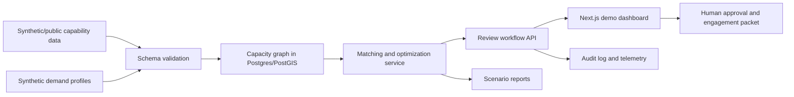

# DLA26BZ02-NV010 RubberFit CapacityNet Proposal Scope

Date: 2026-05-10 America/Los_Angeles
Status: Standalone proposal-scope draft for Arc & Anchor-only pursuit
Product framing: RubberFit CapacityNet
Source context:
- Main scan: `/Users/danielmartinezjulio/Work/arc and anchor/sigilix/docs/opportunities/2026-05-10-dsip-active-topic-fit-scan.md`
- DLA source text: `/tmp/DLA_SBIR_26.BZ_R2.txt`

## DSIP Identifiers And Links

| Field | Value |
| --- | --- |
| Topic code | [`DLA26BZ02-NV010`](https://www.dodsbirsttr.mil/topics/api/public/topics/d05de25f092046b6aeecb1a82cfccfbb_86500/details) |
| Topic title | Enhancing Tertiary Manufacturing Capacity Utilization with Secure Data Practices |
| topicId | `d05de25f092046b6aeecb1a82cfccfbb_86500` |
| Topic details API | <https://www.dodsbirsttr.mil/topics/api/public/topics/d05de25f092046b6aeecb1a82cfccfbb_86500/details> |
| DSIP topics app | <https://www.dodsbirsttr.mil/topics-app/> |
| DLA instructions | <https://www.dodsbirsttr.mil/submissions/api/public/download?uploadId=1736714> |
| Local source PDF attachment | [DLA26BZ02-NV010_DLA_SBIR_26.BZ_R2.pdf](source-pdfs/DLA26BZ02-NV010_DLA_SBIR_26.BZ_R2.pdf) |

## Top-Line Recommendation

Recommendation: conditional go as approval-likelihood priority **#2 of 3** current Arc & Anchor-only SBIR targets, but only as a distinct RubberFit SBIR lane. This is the best non-Sigilix opportunity because it maps directly to RubberFit manufacturing operations, capacity, suppliers, inventory, optimization, and dashboard evidence. It edges `DLA26BZ02-NV005` on approval likelihood because the topic has no DSIP topic-level ITAR flag in the current scan and carries lower agentic-cyber misuse risk, even though it is a less direct Sigilix story.

Arc & Anchor-only likelihood score: 6 / 10 with current evidence. Increase to 7 / 10 if Phase 0 produces a working CapacityNet demo, a clear data schema, and at least one non-contingent support or discovery letter. Current estimated competitive Phase I proposal odds are 35-50%; award odds are 20-35% because the topic likely attracts teams with existing university, lab, or industrial-base relationships.

Pursuit posture: propose a small, secure, unclassified proof of concept that demonstrates the core mapping, matching, and data-governance mechanics using synthetic and public data only. Do not claim access to real DLA demand, controlled technical data, or institutional production schedules unless those are actually obtained. If the team wants a Sigilix-only proposal package, deprioritize this in favor of `DLA26BZ02-NV005`; if the team wants maximum approval likelihood across all Arc & Anchor repos, keep this second.

## Solicitation Snapshot

| Item | Planning Note |
| --- | --- |
| Status in scan | Pre-release |
| Open date | 2026-05-27 |
| Close date | 2026-06-24 |
| Q&A close | 2026-06-10 |
| Program | SBIR |
| Phase path | Phase I, Phase II, Sequential Phase II possible |
| Phase I cap | Up to $100,000 |
| Phase II cap | Up to $1,000,000 unless approved by DLA Program Manager |
| Phase III | No SBIR/STTR-coded funding; DLA or other customer funding may be used |
| Contract type noted in DLA instructions | Phase I Firm-Fixed-Price; Phase II Firm-Fixed-Price/Level-of-Effort |
| CMMC | Projected CMMC Level 2 (Self) |
| ITAR/EAR | Main scan says no ITAR flag in DSIP detail. NV010 source text does not include the topic-level ITAR restriction language seen on other DLA topics. DLA instructions still warn most DLA topics may be ITAR/EAR if the topic write-up indicates. Confirm in Q&A and keep the demo unclassified, non-CUI, synthetic/public-data-only. |
| Phase I duration inconsistency | Topic header says "Not to exceed a duration of 6 months and a cost of $100,000." Body says the feasibility study "must be accomplished within 12 months" for the same cost. Plan for a 6-month Phase I unless Q&A confirms 12 months controls. Ask DSIP to clarify. |

Other DLA proposal implications:
- Technical volume: DLA instructions state a 20-page technical volume limit for Phase I.
- Volume 5: letters of support are optional and should not be contingent on subcontract award.
- DLA standard Phase I deliverables include a Plan of Action and Milestones, initial and final public project summaries, monthly status reports, draft final report, final report, commercialization and transition plan, and applicable patent documentation.
- Selected offerors may be invited to a 15-minute presentation plus 15-minute Q&A; presentation outcome is Go/No-Go.
- DLA says Phase I contracts are not typically classified, but if classified work appears later the contractor must have appropriate facility and personnel clearances. This proposal should explicitly avoid classified data.

## Product Framing

RubberFit CapacityNet is a secure manufacturing capacity discovery and matching system. It lets DLA search, score, and engage tertiary manufacturing capacity from educational institutions, research labs, maker spaces, technical colleges, and other nontraditional facilities during surge, emergency, sustainment, or replacement-part demand.

The product thesis:
- DLA needs more than a contact directory. It needs a continuously updated capability graph that captures machines, materials, skills, certifications, availability windows, location, security posture, and engagement constraints.
- Tertiary institutions need low-friction ways to share capacity without overexposing sensitive internal data.
- A practical Phase I system can prove feasibility with synthetic institutions, synthetic/public capabilities, public taxonomies, and synthetic demand profiles before any controlled or partner data is introduced.
- RubberFit gives Arc & Anchor existing manufacturing-software credibility: material use, production planning, packing optimization, suppliers, inventory, procurement, RBAC, cost tracking, and dashboards.

Positioning sentence:

> RubberFit CapacityNet turns distributed educational and research manufacturing capacity into a governed, searchable, and matchable reserve network for DLA surge and sustainment needs.

## Why RubberFit Fits

RubberFit should be cited as production evidence, not as a finished answer to the DLA topic. The credible bridge is that RubberFit already handles manufacturing operations concepts that CapacityNet can generalize from rubber fabrication to distributed manufacturing-capability discovery.

Evidence to cite:
- Manufacturing CRM for customer, job, and production workflow management.
- Industrial nesting and layout engine with 2D geometry, collision detection, packing, waste calculations, and material utilization logic.
- Inventory, supplier, procurement, purchase order, reorder, and cost-tracking workflows.
- Role-based access control and operational dashboards.
- Waste analytics and material utilization dashboards.
- Desktop Tauri AutoNest and Free Roam packing workflows.
- Existing ability to discuss manufacturing constraints in software terms: materials, machine limits, utilization, production readiness, and operational visibility.

How to frame the evidence:
- "RubberFit proves Arc & Anchor can build manufacturing operations software with real production constraints."
- "CapacityNet extends this foundation from shop-floor optimization to network-level capacity discovery and demand matching."
- "The Phase I work is not to repackage RubberFit; it is to develop and demonstrate a secure capacity graph, matching engine, and data-sharing protocol that can later interoperate with DLA environments."

Known weakness to acknowledge:
- RubberFit is currently specialized around rubber fabrication and material optimization. NV010 asks for a broader network covering many manufacturing processes and institutional capabilities. The proposal should reduce this risk by starting with a representative manufacturing capability taxonomy and a focused set of process families rather than claiming universal manufacturing coverage in Phase I.

## Demo Architecture And Data Plan

The proposal demo should use synthetic and public manufacturing capability and demand data only. No CUI, export-controlled drawings, real DLA demand records, private institutional schedules, personal contact data, or proprietary facility data should be required for Phase I.

### Demo Data

Synthetic facility data:
- Fictional universities, research labs, technical colleges, maker spaces, and institutional shops.
- Facility attributes: location, organization type, security posture, hours, surge availability, point-of-contact role placeholders, and data-sharing status.
- Capability attributes: process family, machine type, build envelope, tolerances, materials, throughput, quality controls, staffing, certifications, inspection capability, and availability windows.
- Engagement attributes: NDA status, approval workflow, expected lead time, shipping radius, minimum order constraints, and insurance/safety constraints.

Public reference data:
- Public process and industry taxonomies such as NAICS, Product Service Codes/Federal Supply Classes, and non-controlled machine/process terminology.
- Public geospatial references such as state, county, city, and distance bands; use coordinates only for fictional or coarse public locations.
- Public university or lab capability pages may be used only as inspiration for generic process categories, not as asserted live capacity unless permission is obtained.

Synthetic demand data:
- Fictional defense-related demand profiles using generic part families and non-controlled attributes.
- Examples: machined bracket, laser-cut gasket, polymer fixture, electronics enclosure, metal test coupon, replacement handle, calibration block.
- Demand attributes: material, process, geometry class, tolerance class, quantity, urgency, inspection need, location, packaging, compliance constraints, and engagement sensitivity.

Data controls:
- Every demo record must include `data_source_type` with one of `synthetic`, `public_reference`, or `derived_demo`.
- Every synthetic entity must be clearly marked as synthetic in the UI and API.
- The schema should block upload of controlled drawings or technical data in Phase I.
- Logs should redact free-text fields by default and preserve only event metadata needed for auditability.

### Technical Architecture

Core services:
- FastAPI backend for ingestion, search, matching, scoring, and workflow APIs.
- Next.js dashboard for map/search, demand intake, fit score explanation, and engagement workflow.
- Postgres/PostGIS for facility, capability, availability, and geospatial search.
- DuckDB for repeatable local analytics, scenario runs, and evaluator-friendly demo notebooks or exports.
- OR-Tools for optimization when matching demand bundles to constrained capacity windows.
- dbt for transforming staged synthetic/public data into validated capability and demand models.
- Great Expectations for data quality checks, schema completeness, null constraints, and referential integrity.
- JSON Schema for API contracts, facility profile submissions, demand profiles, and engagement packet structures.
- OpenTelemetry for API traces, matching latency, ingestion events, and audit observability.
- Keycloak or Ory for demo-grade identity, RBAC, tenant separation, and auditable login/access controls.
- Supabase/Postgres may be used for fast Phase 0/Phase I demo hosting if the deployment remains portable to standalone Postgres for DLA environments.

Ontology and standardization choices:
- ISA-95/B2MML concepts for organization, site, area, work center, personnel, material, and equipment hierarchy.
- MTConnect and OPC UA concepts as future adapter targets for machine state and availability telemetry, without requiring live machine integration in Phase I.
- GeoJSON for geospatial facility and service-radius data.
- QUDT or equivalent unit conventions for dimensions, tolerances, quantities, and rates.
- JSON-LD/RDF can be considered for Phase II if DLA wants semantic graph interoperability, but Phase I should keep the implementation inspectable and practical.

### Matching Model

Initial matching should be explainable rather than opaque:
- Hard filters: process family, material compatibility, build envelope, tolerance class, security/compliance eligibility, geographic constraints, and availability.
- Scored factors: lead time, throughput, inspection capability, prior validation score, engagement friction, distance, surge flexibility, and data freshness.
- Optimization: bundle demand across multiple facilities when a single facility cannot satisfy quantity or timeline.
- Human review: every proposed match should generate an explanation and require human approval before engagement.

Suggested score components:
- Capability fit: 35%
- Availability and throughput: 20%
- Quality/compliance fit: 15%
- Location/logistics: 10%
- Engagement readiness: 10%
- Data freshness/confidence: 10%

## Phase 0: Pre-Proposal Sprint

Purpose: create enough concrete evidence before submission to make an Arc & Anchor-only proposal credible.

Duration: 5-10 business days before or during the open period.

Funding: internal, not charged to SBIR. Keep this lean; the output is proposal evidence, screenshots, a short demo video, and technical volume material.

Work packages:

| WP | Work Package | Output |
| --- | --- | --- |
| 0.1 | Topic and compliance alignment | One-page compliance memo covering CMMC Level 2 Self, ITAR/EAR open item, synthetic-data-only demo boundary, and Phase I duration question. |
| 0.2 | Capability schema | JSON Schema for facility, machine, capability, availability, demand, match, and engagement packet objects. |
| 0.3 | Synthetic dataset | 25-50 fictional institutions, 100-250 capabilities, and 25-50 synthetic demand profiles. |
| 0.4 | Matcher spike | Explainable rule/scoring matcher with top-5 recommendations and reasons. |
| 0.5 | Dashboard shell | Next.js screen showing demand intake, map/list search, fit score, and engagement workflow. |
| 0.6 | RubberFit evidence packet | Screenshots, architecture notes, and short writeups tying RubberFit operations, optimization, inventory, procurement, suppliers, RBAC, and dashboards to CapacityNet. |
| 0.7 | Proposal narrative | Draft technical approach, work plan, risk table, transition story, and Q&A list. |

Phase 0 success metrics:
- Demo can run locally or in a controlled web staging environment with no real sensitive data.
- At least 90% of synthetic records pass schema validation and Great Expectations checks.
- Matcher returns explainable top-5 results for at least 20 demand profiles.
- UI clearly marks data as synthetic/public.
- Proposal can honestly claim a working proof-of-concept baseline without overclaiming institutional access.

Phase 0 go/no-go:
- Go if the demo and evidence packet are coherent by June 10, 2026, so Q&A can be informed.
- No-go if the topic owner indicates real institutional partner letters are required for Phase I submission and Arc & Anchor cannot obtain them quickly.

## Phase I: Feasibility And Proof Of Concept

Planning assumption: build a 6-month plan because the topic header says Phase I is not to exceed 6 months. Include an explicit note that the body text says within 12 months and ask DSIP which duration controls.

Funding target: $100,000 Firm-Fixed-Price.

Phase I objective: prove that CapacityNet can securely represent tertiary manufacturing capacity, accept continuous or periodic capability updates, map capacity to synthetic/public defense manufacturing demand profiles, and generate auditable engagement packets.

### Phase I Work Packages

| WP | Work Package | Concrete Work | Deliverables |
| --- | --- | --- | --- |
| 1.1 | Representative capability model | Define institution types, process families, machine profiles, capacity dimensions, availability model, quality attributes, and engagement constraints. | Report identifying and documenting representative tertiary manufacturing capabilities; capability taxonomy; facility/capability JSON Schema. |
| 1.2 | Secure data exchange protocol | Define API submission, CSV upload, validation, RBAC, tenant scoping, audit log, encryption assumptions, and data provenance labels. | Secure protocol feasibility document; API contract; data-classification matrix; audit model. |
| 1.3 | Legal and engagement framework | Draft non-legal-advice templates for NDA, data-use terms, institution onboarding, and engagement approval workflow. | Template legal framework, sample NDA, data-sharing checklist, engagement packet template. |
| 1.4 | Capacity database and data quality pipeline | Implement Postgres/PostGIS schema, synthetic/public data generator, dbt transformations, Great Expectations checks, and DuckDB scenario exports. | Working capacity database; seeded synthetic/public dataset; data quality report. |
| 1.5 | Demand mapping and matching engine | Build explainable filters, weighted scoring, OR-Tools optimization for bundled demand, and match explanation output. | Proof-of-concept demand-mapping system; match explanation reports; scenario test results. |
| 1.6 | Dashboard and workflow demo | Build Next.js/FastAPI prototype with demand intake, capacity search, map/list view, fit-score explanation, approval workflow, and exportable engagement packet. | Functional proof-of-concept demo; screenshots; demo script; user workflow documentation. |
| 1.7 | Security and compliance analysis | Map prototype controls to CMMC Level 2 Self expectations, NIST SP 800-171 concepts, access control, logging, and no-CUI/no-ITAR assumptions. | Security feasibility report; risk register; Phase II compliance backlog. |
| 1.8 | Validation and Phase II plan | Run synthetic scenario tests, measure match quality, document limits, and write transition plan. | Final report; Phase II development plan with milestones, performance goals, resources, and transition path. |

### Phase I Budget Logic

Target allocation:
- $15,000: program management, POAM, DLA reviews, reporting, final technical volume support.
- $18,000: capability schema, synthetic/public data model, manufacturing taxonomy, and data quality design.
- $22,000: backend, Postgres/PostGIS, API, validation, and ingestion implementation.
- $18,000: matching engine, OR-Tools optimization spike, scenario testing, and metrics.
- $15,000: Next.js dashboard, workflow, engagement packet, demo hardening.
- $7,000: security/compliance analysis, RBAC, audit logging, CMMC Level 2 Self mapping.
- $5,000: commercialization, Phase II plan, presentation materials, and contingency.

Budget rationale: Phase I is labor-heavy and should avoid subcontract dependency. The major cost is engineering a credible proof of concept and producing defensible feasibility evidence. Keep tooling open source to avoid licensing cost and to simplify transfer to DLA-controlled environments.

### Phase I Success Metrics

Minimum technical metrics:
- Ingest at least 50 synthetic institutions, 250 synthetic capabilities, and 100 synthetic demand profiles.
- Validate at least 95% of seeded records against JSON Schema and Great Expectations checks.
- Return top-5 matches for at least 95% of feasible synthetic demand profiles.
- For curated synthetic ground-truth scenarios, include a valid match in top-5 at least 80% of the time.
- Complete standard match queries in under 2 seconds on the demo dataset.
- Generate an auditable engagement packet for every approved match.
- Preserve audit events for data ingestion, demand creation, match generation, score override, and engagement packet export.
- Demonstrate RBAC roles for administrator, DLA reviewer, institution contributor, and read-only auditor.

Minimum proposal/transition metrics:
- Produce all topic-requested Phase I deliverables.
- Produce a Phase II plan that identifies required DLA J68 ARTET integration assumptions.
- Keep all demo data synthetic/public and marked as such.
- Produce a security roadmap showing what changes are needed before handling CUI, partner data, or controlled technical data.

### Phase I Transition Story

Phase I should end with DLA able to see:
- How capacity is represented.
- How an institution would publish or update capabilities.
- How a demand profile is matched to capacity.
- How DLA can inspect the reason for a match.
- How engagement is gated by legal, security, and human approval steps.
- How the system can mature into a DLA J68 ARTET demonstration in Phase II.

The Phase I final report should avoid implying that the prototype is operationally ready. It should state that the prototype has demonstrated feasibility on synthetic/public data and is ready for partner-informed testing and DLA environment alignment in Phase II.

## Phase II: Prototype Development And Relevant-Environment Demonstration

Funding target: up to $1,000,000 over up to 24 months.

Phase II objective: mature CapacityNet into a functional prototype that can be demonstrated in the DLA J68 ARTET environment, tested with partner-informed or approved scenario data, receive continuous updates, map capacity to demand, and operate under validated security protocols.

### Phase II Work Packages

| WP | Work Package | Concrete Work | Deliverables |
| --- | --- | --- | --- |
| 2.1 | Enterprise architecture and DLA environment alignment | Harden deployment model, define ARTET integration plan, package infrastructure-as-code, and document interfaces. | Deployment architecture; ARTET integration plan; environment readiness checklist. |
| 2.2 | Partner onboarding and data governance | Develop institution onboarding workflow, data-sharing agreements, data minimization rules, and validation gates. | Onboarding packet; refined legal/data-sharing templates; partner scenario test plan. |
| 2.3 | Continuous data update capability | Implement API, upload, polling, and manual attestation workflows for capability and availability updates. | Continuous update service; data freshness dashboard; update audit trail. |
| 2.4 | Advanced matching and surge simulation | Add demand bundling, capacity allocation, urgency weighting, what-if scenarios, and conflict handling. | Enhanced matching engine; surge scenario reports; optimization performance report. |
| 2.5 | Security protocol maturation | Strengthen RBAC, audit logging, tenant separation, encryption, incident response procedures, and CMMC/NIST control evidence. | Validated cybersecurity protocol set; control evidence package; security test report. |
| 2.6 | User workflow and operational dashboard | Build DLA reviewer workflows, institution contributor workflows, map/search views, queue management, approval gates, and exportable reports. | Functional prototype; user guide; training materials; demonstration script. |
| 2.7 | Scenario testing and validation | Run real-world or partner-informed scenarios if authorized; otherwise run DLA-approved synthetic scenarios. Measure security, efficiency, and matching performance. | Final scenario test report; test data package; performance metrics. |
| 2.8 | Phase III commercialization and transition plan | Define procurement path, pricing, sustainment, support, integrations, and expansion beyond DLA. | Detailed Phase III commercialization and transition plan. |

### Phase II Budget Logic

Target allocation:
- $120,000: program management, DLA coordination, monthly reviews, reporting, and transition management.
- $150,000: enterprise architecture, deployment packaging, ARTET alignment, and DevSecOps.
- $180,000: data platform, continuous update services, Postgres/PostGIS scaling, dbt pipelines, and data quality automation.
- $170,000: matching engine, optimization, surge simulation, scenario tooling, and performance testing.
- $140,000: security engineering, access control, audit, compliance evidence, and protocol validation.
- $140,000: web application, workflows, dashboards, reports, and UX hardening.
- $60,000: partner onboarding materials, data governance, legal-template refinement, and scenario coordination.
- $40,000: commercialization plan, training material, documentation, and contingency.

Budget rationale: Phase II shifts from feasibility to relevant-environment prototype and security maturation. The biggest risks are integration, data governance, and validation with credible scenario data, so the budget should fund hardened engineering and DLA-facing evidence rather than a large research subcontract.

### Phase II Success Metrics

Prototype metrics:
- Demonstrate a functional prototype in or aligned to DLA J68 ARTET environment expectations.
- Support at least 250 institution/facility profiles and 2,500 capability records in test.
- Receive and validate continuous updates through at least two ingestion modes, such as API and structured upload.
- Track data provenance, freshness, and attestation for 100% of capability records.
- Produce match explanations and engagement packets for 100% of approved matches.
- Complete median match queries under 3 seconds for test-scale data.
- Maintain complete audit logs for ingestion, access, matching, approval, override, and export events.

Validation metrics:
- Achieve at least 85% top-5 valid-match inclusion on adjudicated synthetic or authorized partner-informed test scenarios.
- Demonstrate demand bundling across multiple facilities for constrained quantity or timeline scenarios.
- Demonstrate role-based separation for DLA user, institution contributor, administrator, and auditor.
- Demonstrate cybersecurity protocol compliance against the agreed Phase II control set.
- Deliver test data showing continuous updates, capacity-to-demand mapping, and operation under security protocols.

### Phase II Transition Story

Phase II should show DLA that CapacityNet can move from a proof of concept into a controlled operational pilot:
- DLA can onboard institutions through a governed workflow.
- Institutions can share narrowly scoped capacity data without exposing unrelated operational data.
- DLA users can issue demand profiles and inspect explainable match results.
- Security reviewers can audit who saw or changed data and why.
- Program managers can measure surge readiness, capacity gaps, and engagement friction.

The Phase II endpoint should be a DLA-ready pilot package: deployable software, data model, security evidence, training materials, test results, and a Phase III acquisition path.

## Phase III: Transition, Commercialization, And Dual Use

Funding: no SBIR/STTR-coded funding. Phase III would use DLA, Service, government, commercial, or other non-SBIR funds. DLA instructions say Phase III proposals are submitted directly to the DLA SBIR PMO and may follow Phase II-style content, with no stated funding or period-of-performance limits.

Phase III objective: transition CapacityNet into an operational manufacturing reserve network for DLA and adjacent government or commercial supply-chain resilience use cases.

### Phase III Work Packages

| WP | Work Package | Output |
| --- | --- | --- |
| 3.1 | Operational deployment | Production deployment package, hosting decision, support model, monitoring, backup, and continuity plan. |
| 3.2 | DLA integrations | Interfaces for DLA demand sources, identity, reporting, procurement workflow, and approved data exchange paths. |
| 3.3 | Institution network scaling | Onboarding campaigns, training, data-sharing agreements, institution scorecards, and support playbooks. |
| 3.4 | Civil Reserve Manufacturing Network expansion | Surge readiness dashboards, regional capacity maps, disaster response scenarios, and cross-agency reporting. |
| 3.5 | Commercial productization | Packaging for automotive, aerospace, electronics, and industrial supply-chain resilience customers. |
| 3.6 | Sustainment and compliance | Ongoing security monitoring, CMMC evidence maintenance, data quality operations, and customer success. |

### Phase III Business Model

Potential models:
- DLA or government enterprise license plus implementation and sustainment services.
- Hosted SaaS for commercial manufacturing networks where appropriate.
- Private deployment for regulated aerospace, automotive, or electronics supply-chain resilience.
- Data-governance and onboarding services for institutions and regional manufacturing networks.
- Integration services for ERP, MES, procurement, and inventory systems.

### Phase III Success Metrics

- Operational onboarding of real institutions or manufacturing partners under approved agreements.
- Measurable reduction in time to identify viable capacity for a demand profile.
- Measurable increase in visibility into distributed surge capacity.
- Repeatable security and audit evidence for every engagement.
- Commercial pilots outside DLA in at least one industrial vertical with distributed-capacity problems.

## Open-Source Tools, Libraries, And Standards

| Area | Recommended Choice | Role |
| --- | --- | --- |
| Primary datastore | Postgres/PostGIS | Facility, capability, availability, demand, match, audit, and geospatial queries. |
| Hosted demo option | Supabase/Postgres | Fast demo setup if portability to standalone Postgres is preserved. |
| Analytics | DuckDB | Local scenario analytics, reproducible evaluator exports, and lightweight reporting. |
| Transformation | dbt | Versioned transformations from raw synthetic/public inputs to canonical capability models. |
| Optimization | OR-Tools | Demand bundling, constrained allocation, capacity-window matching, and surge scenarios. |
| Data quality | Great Expectations | Schema completeness, allowed values, null checks, freshness checks, and referential integrity. |
| API contracts | JSON Schema | Facility, capability, demand, match, engagement packet, and audit event contracts. |
| Backend | FastAPI | Typed API service for ingestion, search, matching, workflow, and reporting. |
| Frontend | Next.js | Demo dashboard for DLA reviewer and institution contributor workflows. |
| Identity | Keycloak or Ory | RBAC, identity, session management, and audit-friendly access control. |
| Observability | OpenTelemetry | Traces, matching latency, ingestion events, audit-adjacent telemetry, and reliability evidence. |
| Manufacturing hierarchy | ISA-95/B2MML concepts | Organization, site, area, work center, equipment, material, personnel, and operation model. |
| Machine telemetry future target | MTConnect and OPC UA concepts | Future machine-state and availability adapters; not required for Phase I live integration. |
| Geospatial data | GeoJSON, PostGIS | Facility location, service radius, distance bands, and regional capacity mapping. |
| Units and measures | QUDT-style conventions | Dimensions, quantities, rates, tolerances, and unit conversion discipline. |
| Security controls | NIST SP 800-171 concepts, CMMC Level 2 Self mapping | Phase I/II control planning for controlled data handling if later authorized. |

Tooling principle: use open-source components where possible and keep the architecture deployable without vendor lock-in. Any hosted convenience used in Phase 0 or Phase I should have a clear path to DLA-controlled deployment.

## Risks And Mitigations

| Risk | Impact | Mitigation |
| --- | --- | --- |
| DLA expects real institution relationships at Phase I submission | Could weaken Arc & Anchor-only credibility | Ask DSIP Q&A; pursue at least one non-contingent support/discovery letter; make Phase I demo self-contained. |
| Phase I duration ambiguity | Schedule and budget uncertainty | Plan to 6 months; ask whether 6 or 12 months controls; design work packages that can compress. |
| ITAR/EAR ambiguity | Compliance risk | Use synthetic/public data only; avoid controlled drawings; ask Q&A whether TCP is expected for NV010. |
| CMMC Level 2 Self expectations | Security evidence burden | Scope Phase I as no-CUI; map controls early; implement RBAC, logging, data provenance, and encryption assumptions. |
| RubberFit domain is too narrow | Reviewer may see weak fit | Position RubberFit as manufacturing-software proof, not the final product; build broader capability taxonomy in Phase 0. |
| "AI-driven" is interpreted as generative AI | Mismatch between proposal and evaluator expectation | Describe explainable matching, optimization, and optional natural-language assistance; ask whether decision-support AI is sufficient. |
| Data freshness is hard without real integrations | Weak real-time visibility claim | Phase I proves data model and update protocol; Phase II adds continuous update workflows and partner-informed testing. |
| Legal templates may require counsel | Review risk | Label templates as sample framework for evaluation; state Phase II/III will include legal review before operational use. |
| DLA J68 ARTET access assumptions are unknown | Phase II integration risk | Ask Q&A what access, environment constraints, and integration artifacts are expected. |

## Go/No-Go Checklist

Go if all are true:
- Phase 0 demo can show demand intake, capacity search, match scoring, and engagement packet generation using synthetic/public data.
- Q&A does not require formal educational/research institution partner commitments before Phase I submission.
- Arc & Anchor can explain how RubberFit production evidence transfers to distributed capacity discovery.
- Proposal can honestly satisfy CMMC Level 2 Self planning without claiming current handling of CUI.
- The team can write a 6-month Phase I plan under $100,000 with clear deliverables and metrics.
- The demo avoids ITAR/EAR, controlled technical data, DLA-sensitive demand, and private institutional schedules.
- At least one reviewer can validate that the manufacturing taxonomy and matching story are credible.

No-go or pause if any are true:
- DSIP Q&A says real institutional partner letters are mandatory and none can be obtained before close.
- DSIP Q&A says Phase I requires handling CUI, export-controlled technical data, or classified information.
- The Phase 0 demo cannot be made coherent before the Q&A close date of 2026-06-10.
- The proposal would depend on unsupported claims about live manufacturing networks or DLA demand access.
- The team cannot keep this RubberFit lane from distracting from `DLA26BZ02-NV006`, the primary
  higher-priority Sigilix submission.

## Q&A Questions For DSIP

1. Phase I duration clarification: the topic header says "Not to exceed a duration of 6 months" but the Phase I body says the feasibility study "must be accomplished within 12 months." Which duration controls for `DLA26BZ02-NV010`?
2. Are educational or research institution partner letters required for Phase I submission, or are they optional supporting evidence?
3. For Phase I, may offerors use synthetic and public manufacturing capability data to demonstrate the proof of concept, with real institutional data deferred until Phase II under approved agreements?
4. Does the topic require access to DLA demand data during Phase I, or may demand-mapping be demonstrated with synthetic/public demand profiles?
5. The DSIP detail scan shows no ITAR flag and the NV010 topic text does not include a topic-specific ITAR restriction paragraph. Should offerors still prepare a Technology Control Plan or assume ITAR/EAR restrictions for this topic?
6. What CMMC Level 2 Self expectations apply during Phase I if the prototype uses no CUI and no controlled technical data?
7. What does DLA expect for "real-time" visibility in Phase I: live machine telemetry, periodic attestation, API updates, structured uploads, or a protocol demonstration?
8. Is an explainable AI/optimization matching approach acceptable, or does DLA expect generative AI or agentic AI components?
9. What manufacturing process families should be prioritized for the representative sample: machining, additive manufacturing, sheet/laser cutting, electronics, polymers, inspection, or another set?
10. What are the expected interfaces, constraints, or access assumptions for demonstrating the Phase II prototype in the DLA J68 ARTET environment?
11. Should the Phase I legal framework and sample NDA be reviewed by counsel before submission, or is a proposed template framework sufficient for feasibility?
12. What evaluation metrics matter most to DLA: time to find capacity, match quality, data freshness, security controls, institution onboarding speed, surge quantity coverage, or another measure?
13. Should institution contributor workflows include only organization-level contacts, or should the system model individual personnel skills and availability?
14. Are there preferred DLA, DoD/DoW, or federal data standards for manufacturing capability, facility, product classification, or supply-chain data that offerors should align to?
15. Does DLA prefer a DLA-hosted deployment path, a vendor-hosted pilot, containerized delivery, or another Phase II deployment model?

## Proposal Writing Notes

Main claim to make:
- Arc & Anchor can build the secure data model, matching engine, and operational workflow because RubberFit already demonstrates manufacturing operations, optimization, inventory, suppliers, procurement, RBAC, and dashboards.

Claims to avoid:
- Do not claim an existing tertiary manufacturing network.
- Do not claim current access to DLA demand data.
- Do not claim the Phase I prototype is ready for CUI, ITAR, or classified data.
- Do not imply legal templates are final legal advice.
- Do not overemphasize generic AI language at the expense of manufacturing capacity, security, and transition.

Suggested proposal angle:
- "A practical, secure, explainable capacity graph and matching workflow for DLA surge manufacturing."
- "Start with synthetic/public-data feasibility; mature into partner-informed relevant-environment testing in Phase II."
- "Use open-source, portable infrastructure and strong auditability to lower DLA adoption risk."
