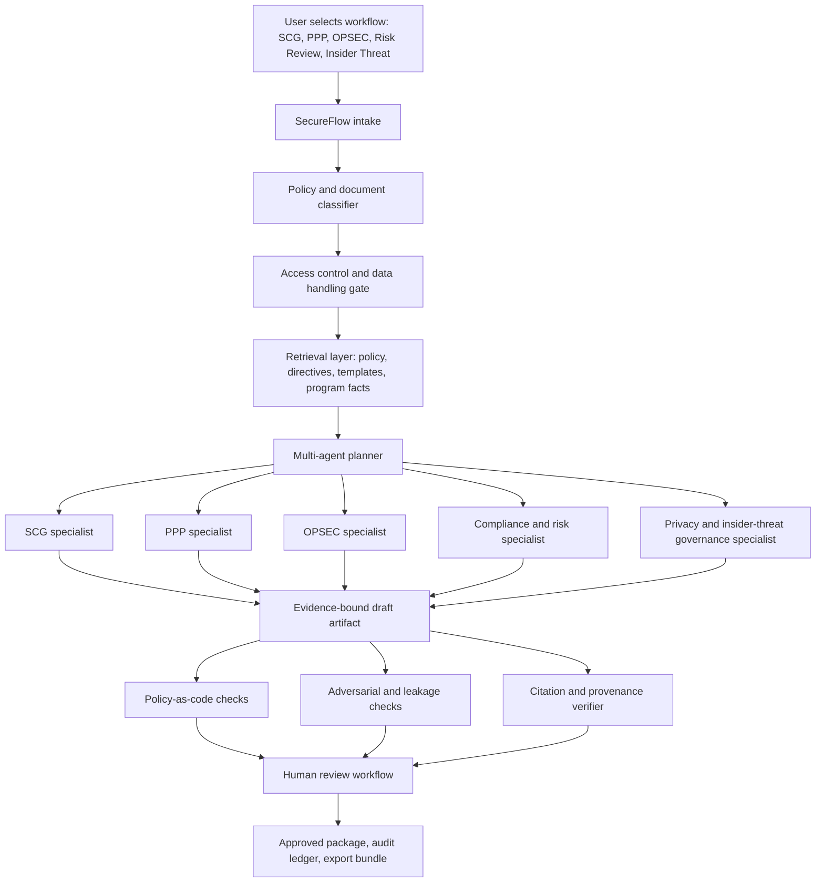

# OSW26BZ02-DV003 Draft: Sigilix SecureFlow for Secure Workflow Automation and Compliance

Date: 2026-05-10 America/Los_Angeles
Status: Deep draft proposal artifact
Source topic: `OSW26BZ02-DV003: Generative AI for Secure Workflow Automation and Compliance`
Component: `OSD / Strategic Capabilities Office (SCO)`
Solicitation: `DoW SBIR 2026 BAA`, Release 2, cycle `DOD_SBIR_2026_P1_CBZ`
Submission type: `Direct to Phase II only`
Public listing dates: pre-release 2026-05-06; open 2026-05-27; close 2026-06-24
Primary product name: **Sigilix SecureFlow**
Recommended repository: `arc-and-anchor/sigilix-secureflow`

## Executive Thesis

This is a materially stronger Sigilix opportunity than `DAF26BZ01-DV005`. The scene-construction
topic required RF, EO/IR, geospatial, and simulator-domain credibility that Sigilix does not yet
possess. `OSW26BZ02-DV003` asks for a secure, enterprise-grade Generative AI platform that automates
security, compliance, risk, and administrative workflows. That maps directly to the production
capabilities already present in Sigilix:

- production LLM orchestration;
- multi-agent specialist review and synthesis;
- deterministic evidence injection;
- retrieval and indexed memory;
- structured JSON output handling;
- asynchronous queues and durable execution;
- human-in-the-loop review;
- policy-aware automation;
- audit-oriented review artifacts;
- security findings, SARIF, dependency, and secret evidence channels.

The strongest proposal posture is:

> Sigilix is already a production AI workflow and assurance platform. For OSW26BZ02-DV003, Arc and
> Anchor will adapt the proven Sigilix architecture into Sigilix SecureFlow: a secure, evidence-bound,
> deployable GenAI toolkit for SCG drafting, PPP drafting, OPSEC planning, policy/risk review, and
> bounded insider-threat workflow support.

The proposal should not sound like a generic chatbot or document generator. It should sound like a
controlled workflow system where LLMs are one component inside a governed, auditable, policy-driven
automation platform.

## Bottom-Line Viability

Sigilix is viable for this topic in a way it was not viable for the multimodal scene-generation topic.
The core technology is already adjacent to the solicitation. The main gap is not software architecture.
The main gap is Direct-to-Phase-II evidence around government security workflows and classified
deployment credibility.

Recommended posture:

1. **Best posture: Arc and Anchor primes with a cleared defense/security partner or senior advisor.**
   Sigilix supplies the working AI workflow product and technical platform. The partner strengthens
   classified-program credibility, SCG/PPP/OPSEC domain expertise, and transition trust.
2. **Strong posture: Arc and Anchor primes with letters of support from defense contractors, FSO/security
   professionals, or former government security/compliance users.** This can be enough if the demo is
   strong and feasibility evidence is clear.
3. **Risky posture: Sigilix-alone prime with no classified/security-domain partner.** The product fit is
   strong, but the topic explicitly asks for classified-program experience up to TS/SCI and government
   security process acumen. Without a partner/advisor, reviewers may see the team as technically strong
   but operationally unproven for this exact environment.

Probability estimate if pursued seriously:

- **With a focused demo by 2026-05-27 plus partner/advisor evidence:** moderate to strong.
- **With a focused demo but no partner/advisor:** credible but exposed.
- **With only the existing Sigilix repo and no OSW-specific demo:** weak for Direct-to-Phase-II.

The existing Sigilix system gives us a real advantage over applicants that have not built anything.
But Direct-to-Phase-II requires more than an idea. We need a concrete feasibility bridge: an
OSW-specific prototype, test data, prototype screenshots, architecture diagrams, and a short report
showing that the technology has already been exercised on SCG/PPP/OPSEC/compliance-style workflows.

## Key Solicitation Facts To Anchor The Proposal

The topic is Direct-to-Phase-II only. It expects significant technical maturity before submission and
clear evidence that the offeror has already established feasibility through non-SBIR work.

The DSIP listing and topic detail establish the following:

- Topic code: `OSW26BZ02-DV003`
- Title: `Generative AI for Secure Workflow Automation and Compliance`
- Component: `OSD`
- Command: `SCO`
- Program: `SBIR`
- Solicitation number: `26.BZ`
- Release number: `2`
- Cycle name: `DOD_SBIR_2026_P1_CBZ`
- Pre-release start: `2026-05-06 05:00 PDT`
- Open date: `2026-05-27 05:00 PDT`
- Close date: `2026-06-24 09:00 PDT`
- TPOC Q&A window in DSIP: starts `2026-05-06`; TPOC pre-release Q&A ends `2026-05-27`; topic Q&A
  ends `2026-06-10`
- Projected CMMC level: `Level 1`
- ITAR/EAR: flagged as restricted
- Topic keywords: Generative AI, LLM, SCG, PPP, OPSEC, automation, compliance, risk management,
  insider threat, Direct to Phase II

The Phase II MVP modules named in the topic are:

- Security Classification Guide Builder
- Program Protection Plan Builder
- OPSEC Plan Builder
- Policy, Compliance, and Risk Review Tools
- Insider Threat Management Module

The proposal must show:

- secure and fine-tuned LLM advantage;
- accuracy;
- explainability;
- data privacy;
- robustness against adversarial manipulation;
- roadmap to classified deployment up to TS/SCI;
- integration path with existing DoW systems;
- prior feasibility evidence, not just a future plan.

## Critical Schedule And Scope Catch

There is a schedule inconsistency to handle carefully:

- The topic Phase II text says the goal is an MVP within an **18-month period of performance**.
- The SCO Direct-to-Phase-II instructions say the SCO Direct-to-Phase-II period of performance is
  **12 months** and the award may be up to **$2,000,000**.

The proposal should be written so it can survive either interpretation:

- Build the main MVP plan as a 12-month plan, because component instructions are likely controlling.
- Include an optional extension/scale plan for months 13-18 if the topic office confirms the longer
  period.
- Ask a TPOC Q&A question during pre-release/open Q&A:

```text
The topic Phase II section references an 18-month MVP period, while the SCO Direct-to-Phase-II
instructions state a 12-month period of performance. Should offerors plan the technical schedule and
cost volume for a 12-month or 18-month Phase II effort?
```

## Recommended Product Positioning

Use **Sigilix SecureFlow** as the defense/compliance product name.

Do not position the product as "the existing GitHub code review bot." That undersells it and makes the
proposal sound misaligned. Instead:

> Sigilix SecureFlow is a secure workflow automation and compliance platform derived from Sigilix's
> production AI orchestration architecture. It applies the same evidence-bound, multi-agent, human
> review, and audit-first patterns to high-consequence government documentation workflows.

The proposal should repeatedly make these distinctions:

- Sigilix is the proven production substrate.
- SecureFlow is the OSW-specific product and Phase II prototype vehicle.
- The existing code-review use case proves the hard AI operations layer.
- The Phase II work adapts it to SCG, PPP, OPSEC, compliance, and insider-threat workflows.

## Separate Repository Strategy

Use a separate repository:

```text
sigilix                    -> existing production AI code-review and assurance product
sigilix-secureflow         -> OSW/SCO secure workflow automation and compliance product
```

The proposal language should say:

> Sigilix SecureFlow will be developed as a dedicated sibling repository and deployment boundary. This
> preserves the proven Sigilix AI workflow architecture while isolating government compliance
> workflows, controlled-document handling, classified-deployment preparation, model governance,
> security testing, and customer-specific integrations from the commercial code-review product.

Why this matters:

- **Compliance boundary:** CMMC, export-control, foreign-national, controlled-data, and future
  classified-deployment requirements should not be entangled with the commercial code-review repo.
- **Deployment boundary:** SecureFlow needs offline, on-prem, hybrid cloud, and classified-enclave
  deployment paths. The current Sigilix Cloudflare Worker stack is valuable evidence, but not the final
  target deployment shape.
- **Data boundary:** SCG, PPP, OPSEC, and risk documents require stricter handling than GitHub review
  artifacts.
- **Licensing boundary:** open-source model/runtime/RAG/security tooling can be selected and reviewed
  separately for government deployment.
- **Proposal credibility:** a dedicated product line looks intentional and transition-oriented.

Suggested repo layout:

```text
sigilix-secureflow/
  docs/
    opportunity/
    architecture/
    security/
    evals/
    deployment/
  app/
    web/
    api/
    worker/
  packages/
    workflow-core/
    evidence-ledger/
    policy-engine/
    model-gateway/
    document-builders/
    eval-harness/
  corpora/
    public-policy-seed/
    synthetic-programs/
  examples/
    scg-builder-demo/
    ppp-builder-demo/
    opsec-builder-demo/
    compliance-review-demo/
  deploy/
    docker-compose/
    helm/
    airgap/
  tests/
    fixtures/
    adversarial/
```

Do not extract shared Sigilix packages yet unless it becomes necessary. For the demo, copying patterns
is acceptable. For Phase II, shared packages can be formalized:

- `@arc-and-anchor/sigilix-agent-core`
- `@arc-and-anchor/sigilix-evidence`
- `@arc-and-anchor/sigilix-policy`
- `@arc-and-anchor/sigilix-model-gateway`

## What Sigilix Can Credibly Claim Today

The proposal can claim existing production capability in these areas:

- Multi-agent LLM workflow orchestration.
- Evidence-bound technical analysis.
- Retrieval-augmented review over repository/document context.
- Structured model outputs and JSON schema validation.
- Asynchronous job execution through queues and durable state.
- Human-in-the-loop review and final synthesis.
- Security review workflows with deterministic evidence channels.
- Traceable outputs with stale/evidence markers.
- Integration with operational systems such as GitHub and Linear.
- Production tests and TypeScript/Cloudflare Worker deployment maturity.

Translate those into OSW language:

- GitHub PR becomes "security/compliance workflow packet."
- Repository evidence becomes "policy corpus and program document evidence."
- SARIF/security scans become "policy/risk/OPSEC findings."
- Review memory becomes "case history and decision rationale memory."
- Multi-agent reviewers become "SCG, PPP, OPSEC, compliance, privacy, and red-team specialists."
- Final review synthesis becomes "human-reviewable artifact package with traceable citations."
- Linear triage becomes "tasking, waiver, mitigation, and stakeholder action queue."

This is a defensible bridge. It is not claiming the existing product already writes SCGs. It is claiming
the expensive AI operations layer already exists and the Phase II work adapts it to named government
security workflows.

## What Sigilix Should Not Claim

Do not claim:

- that Sigilix is already deployed in classified environments;
- that Sigilix already generates authoritative SCGs, PPPs, or OPSEC plans;
- that an LLM can make binding classification decisions;
- that the system replaces security officers, original classification authorities, FSOs, or OPSEC
  reviewers;
- that insider-threat functions can autonomously identify personnel risk without governance;
- that CMMC Level 1 means the classified roadmap is solved;
- that public policy corpora are enough for real DoW SCG/PPP production use.

Instead claim:

> SecureFlow drafts, reviews, cross-checks, explains, and routes artifacts for human approval. It reduces
> manual burden and inconsistency while preserving accountable human decision authority.

## Recommended Proposal Win Theme

Use this phrase repeatedly:

> Evidence-bound GenAI for controlled security workflows.

Supporting win themes:

- **Not a chatbot:** governed workflow automation with role-based approvals and immutable audit.
- **Not a black box:** every draft section, recommendation, and risk finding has source grounding and
  confidence metadata.
- **Not cloud-only:** deployable in commercial cloud, GovCloud, on-prem, air-gapped, and eventually
  classified enclaves.
- **Not speculative:** derived from a production Sigilix system that already orchestrates multi-agent AI
  review at scale.
- **Not autonomous authority:** human approval remains mandatory for classification, OPSEC, risk, and
  personnel-impacting decisions.

## Proposed System Architecture



Core components:

- **Model Gateway:** routes requests to approved models based on data sensitivity, task, and enclave.
- **Retrieval Index:** policy, directive, template, and program-document retrieval with source controls.
- **Workflow Engine:** state machine for draft, review, red-team, approval, export, and archive.
- **Document Builders:** SCG, PPP, OPSEC, compliance memo, risk register, mitigation plan.
- **Evidence Ledger:** source citations, model versions, prompts, retrieval chunks, reviewers, approvals,
  policy checks, and generated artifacts.
- **Policy Engine:** role, data, export, and workflow constraints.
- **Evaluation Harness:** accuracy, citation faithfulness, leakage, adversarial robustness, consistency,
  reviewer overrides.
- **Deployment Layer:** Docker Compose for demo; Kubernetes/Helm for Phase II; air-gap bundle for
  transition roadmap.

## MVP Modules

### 1. SCG Builder

Purpose:

Assist authorized personnel in drafting Security Classification Guide sections from approved inputs,
templates, classification guidance, and program facts.

Demo scope:

- Use public or synthetic SCG-like templates only.
- Use a synthetic program packet.
- Generate a draft SCG outline and controlled section text.
- Produce a classification rationale trace.
- Flag missing authority, ambiguity, conflicts, and unsupported claims.
- Require human approval before export.

Phase II scope:

- Integrate customer-provided classification guides and directives.
- Add source priority and authority hierarchy.
- Add conflict detection between guidance documents.
- Add redline mode for reviewer edits.
- Add controlled export formats.

Guardrail:

The system does not make final classification decisions. It drafts and checks artifacts for authorized
human review.

### 2. PPP Builder

Purpose:

Assist in drafting Program Protection Plans by mapping program facts, threats, critical program
information, cybersecurity controls, supply-chain risks, anti-tamper considerations, and protection
measures into a structured plan.

Demo scope:

- Synthetic program profile.
- Public NIST/RMF/CUI control corpus.
- Draft PPP skeleton with evidence-linked sections.
- Risk register and mitigation table.
- Missing-evidence list.

Phase II scope:

- Customer-specific PPP templates.
- Import from program documents and risk registers.
- Control mapping to NIST SP 800-53, NIST SP 800-171, CMMC practices where applicable, and
  customer policy.
- Export to review package and compliance evidence bundle.

### 3. OPSEC Plan Builder

Purpose:

Assist in building OPSEC plans through critical information identification, threat/vulnerability
analysis, risk scoring, mitigation generation, and review workflow.

Demo scope:

- Synthetic mission/program packet.
- Public OPSEC planning references.
- Critical information list.
- Indicator/vulnerability/measure table.
- Human approval gate.

Phase II scope:

- Government-specific OPSEC templates.
- Multi-stakeholder review.
- Risk acceptance workflow.
- Periodic re-review and change detection.

### 4. Policy, Compliance, And Risk Review

Purpose:

Review draft documents against policy corpora, regulations, templates, and risk frameworks.

Demo scope:

- Ingest public NIST, CUI, and security policy documents.
- Review a synthetic PPP/OPSEC artifact.
- Produce findings with severity, cited source, rationale, and remediation.
- Produce an exportable audit report.

Phase II scope:

- Customer corpora.
- OSCAL/control mappings.
- Cross-document consistency checks.
- Waiver and risk-acceptance workflow.
- Continuous review on document changes.

### 5. Insider Threat Management Module

This must be scoped carefully. The solicitation asks for tools to assist in identifying and mitigating
potential insider threats through unstructured data analysis. This is sensitive and easy to overstate.

Recommended scope:

> SecureFlow will provide governed insider-threat workflow support focused on policy compliance,
> document/process risk, anomalous access patterns, and case triage support. It will not autonomously
> label personnel as threats, make employment recommendations, or trigger adverse action.

Demo scope:

- Synthetic incident notes and access logs.
- Policy-grounded triage summary.
- Missing-information checklist.
- Risk factors and mitigating factors.
- Human review and escalation routing.
- Audit trail showing who viewed, edited, and approved the case package.

Phase II scope:

- Integration with approved government data sources only.
- Strict RBAC and need-to-know controls.
- Bias/false-positive evaluation.
- Privacy impact assessment support.
- Case-management integration.
- Full audit and explainability.

## Open-Source Implementation Stack

The open-source stack should be described as implementation leverage, not as a substitute for product
engineering. The proposal should say that SecureFlow uses mature open-source components behind
Sigilix's workflow, evidence, security, and deployment layer.

### Model Serving And Local Inference

- **vLLM**: high-throughput local/open-weight LLM serving for private environments.
- **Text Generation Inference (TGI)**: production model serving option for Hugging Face models.
- **Ollama**: fast local demo and developer iteration.
- **llama.cpp**: CPU/GPU portable inference path for constrained or disconnected environments.
- **Hugging Face Transformers**: model loading, tokenization, and evaluation ecosystem.
- **PEFT / LoRA**: parameter-efficient adaptation for domain-specific drafting and review.
- **TRL**: supervised fine-tuning and preference-alignment experiments where appropriate.
- **Axolotl**: reproducible fine-tuning recipes for open-weight models.

How this helps Phase II:

- lets SecureFlow demonstrate private model execution without sending sensitive data to a commercial
  API;
- supports air-gapped and hybrid deployment claims;
- supports comparison across base, RAG-only, and tuned models;
- provides a path to government-approved model hosting.

### Retrieval, Indexing, And Document Understanding

- **LlamaIndex**: document ingestion, chunking, retrieval pipelines, and agent/RAG evaluation.
- **Haystack**: production-oriented RAG pipelines and retriever/generator abstraction.
- **LangChain / LangGraph**: agentic workflow prototyping and graph-based task orchestration.
- **Apache Tika**: document text extraction from PDFs, Word files, emails, and other formats.
- **Docling**: structured document conversion and layout-aware extraction.
- **Unstructured**: parsing heterogeneous enterprise documents.
- **Qdrant**: vector database with filtering and local deployment.
- **pgvector**: Postgres-native vector retrieval for simple secure deployments.
- **OpenSearch**: hybrid lexical/vector retrieval and enterprise search path.
- **LanceDB**: local embedded vector store for demo/offline bundles.
- **Microsoft GraphRAG**: entity and relationship graph construction across assets, threats,
  controls, critical program information, mitigations, and document sections.

How this helps Phase II:

- supports policy and directive retrieval with source citations;
- supports mixed document formats common in government workflows;
- provides local and enterprise-grade indexing options;
- enables side-by-side retrieval evaluation;
- supports graph-style traceability from program facts to risks, controls, and generated paragraphs.

### Policy-As-Code And Compliance Modeling

- **Open Policy Agent (OPA)**: Rego-based policy checks for workflow rules, export rules, and
  required-document gates.
- **Cedar**: authorization policy language for fine-grained access patterns.
- **OpenFGA**: relationship-based authorization and need-to-know modeling.
- **NIST OSCAL**: machine-readable control catalogs and assessment artifacts.
- **compliance-trestle**: OSCAL authoring and control-profile tooling.
- **oscal-cli**: OSCAL validation and transformation workflows.

How this helps Phase II:

- turns compliance into testable checks rather than prompt-only behavior;
- supports evidence packages mapped to controls;
- helps demonstrate that SecureFlow is a governed workflow system, not a chatbot.

### Security, Privacy, And LLM Red Teaming

- **Microsoft Presidio**: PII detection and anonymization.
- **Gitleaks**: secret detection in uploaded text or repositories.
- **detect-secrets**: additional secret-scanning baseline.
- **NeMo Guardrails**: conversation and tool-use guardrails.
- **Garak**: LLM vulnerability scanner for prompt injection, leakage, and unsafe behavior.
- **PyRIT**: AI red-team automation and adversarial prompt testing.
- **promptfoo**: prompt, RAG, and LLM regression testing.
- **Guardrails AI**: output validation and constrained structured generation.
- **Rebuff**: prompt-injection detection patterns.

How this helps Phase II:

- creates measurable evidence for adversarial robustness;
- supports the solicitation's data privacy and manipulation-resistance requirements;
- gives the feasibility package concrete red-team test results.

### Workflow, Audit, And Provenance

- **Temporal**: durable workflow execution and retries for long-running document workflows.
- **Flowable**: BPMN-style approval workflows for security-office review processes.
- **Argo Workflows**: Kubernetes-native batch and pipeline execution.
- **Apache Airflow**: scheduled ingestion, evaluation, and reporting pipelines.
- **Prefect**: Python workflow orchestration for ingestion/eval jobs.
- **OpenTelemetry**: traces, metrics, and logs across model calls and workflow steps.
- **OpenLLMetry / Traceloop**: LLM-specific tracing over prompts, retrieval, and model calls.
- **Langfuse**: prompt/model/retrieval observability for development and pilot evaluation.
- **OpenLineage**: data lineage for document ingestion and derived artifacts.
- **in-toto**: supply-chain attestations for artifacts.
- **Sigstore / Rekor**: signed provenance and transparency logs.
- **CycloneDX / SPDX**: SBOM generation and software/component inventory.

How this helps Phase II:

- produces audit trails reviewers can inspect;
- supports chain-of-custody for generated documents;
- strengthens transition to government environments.

### Deployment And Identity

- **Docker Compose**: fast demo packaging.
- **Kubernetes / Helm**: Phase II deployability in managed or on-prem clusters.
- **K3s / RKE2**: lightweight and government-friendly Kubernetes options.
- **DoD Platform One Big Bang**: reference path for hardened, GitOps-oriented DoD Kubernetes
  packaging where appropriate.
- **Argo CD**: GitOps deployment and drift detection.
- **Keycloak**: identity, SSO, and role management for demo and pilots.
- **Vault**: secrets management.
- **SPIFFE / SPIRE**: workload identity in higher-assurance environments.
- **SOPS / Sealed Secrets**: encrypted configuration handling.

How this helps Phase II:

- lets SecureFlow show private, repeatable deployment;
- supports a credible path to air-gapped and classified enclaves;
- avoids dependence on a single commercial cloud.

### Evaluation And Quality

- **Ragas**: RAG answer faithfulness and context metrics.
- **DeepEval**: LLM application evaluation and regression testing.
- **lm-evaluation-harness**: model benchmark harness.
- **Inspect AI**: evaluation harness for safety/security-oriented tasks.
- **MLflow**: experiment tracking for model, prompt, retrieval, and eval runs.
- **Great Expectations**: data validation for corpora and metadata.

How this helps Phase II:

- converts qualitative claims into measurable results;
- supports the Direct-to-Phase-II feasibility documentation requirement;
- provides before/after evidence for tuned vs untuned models and RAG configurations.

### Insider-Threat Telemetry And Case Support

- **Wazuh**: open-source security telemetry and SIEM-style event collection.
- **OpenSearch**: searchable audit, event, and case-review index.
- **Sigma**: portable detection-rule format for security events.
- **OpenCTI**: cyber threat intelligence knowledge management.

How this helps Phase II:

- lets SecureFlow demonstrate insider-threat workflow support on synthetic telemetry without touching
  real personnel data;
- keeps the module grounded in case triage, anomaly review, and policy evidence rather than
  autonomous personnel labeling;
- provides a bridge to existing SOC/security operations practices.

## Pre-Opening Demo Plan: 2026-05-10 To 2026-05-27

The open date is 2026-05-27. A solid demo is feasible before then. It should not try to solve all five
modules fully. It should demonstrate the core architecture on one complete workflow plus thin vertical
slices for the other modules.

Recommended demo name:

> Sigilix SecureFlow Feasibility Bridge

Demo goal:

Show that Sigilix can already run an evidence-bound secure workflow that ingests policy and program
facts, drafts a security/compliance artifact, checks it, red-teams it, and produces an audit package.

### Demo Inputs

Use only public or synthetic data:

- public NIST SP 800-53 / SP 800-171 excerpts;
- public CUI Registry references;
- public OPSEC planning references;
- public DoD/RMF/CMMC explanatory materials where allowed;
- synthetic program packet for a fictional system;
- synthetic incident notes for insider-threat triage demo;
- synthetic SCG/PPP/OPSEC templates.

Do not use classified, CUI, proprietary defense contractor data, or real personnel data in the demo.

### Demo Workflow

1. User uploads or selects a synthetic program packet.
2. User selects `PPP Builder`.
3. SecureFlow classifies the document packet as synthetic/unclassified demo data.
4. Retrieval layer indexes policy references and program facts.
5. Planner decomposes the PPP into sections.
6. Specialist agents draft sections with cited evidence.
7. Policy-as-code checks flag missing required sections and unsupported claims.
8. Red-team checks attempt prompt injection and data exfiltration scenarios.
9. Human reviewer approves, edits, or rejects sections.
10. System exports:
    - draft PPP;
    - risk register;
    - evidence trace;
    - model/prompt/retrieval audit;
    - red-team test summary;
    - missing-information checklist.

### Thin Slices For The Other Modules

- SCG Builder: generate outline and rationale table from synthetic program facts.
- OPSEC Builder: generate critical information list and indicator/vulnerability/measure table.
- Compliance Review: scan a draft artifact and produce cited findings.
- Insider Threat: summarize synthetic case notes with privacy/bias/human-review warnings.

### Demo Artifacts To Include In Proposal

- 2-minute screen recording.
- Architecture diagram.
- Screenshots of workflow dashboard.
- Example generated PPP package.
- Example SCG rationale table.
- Example OPSEC matrix.
- Example compliance findings report.
- Example red-team eval report.
- Example audit ledger JSON.
- Model/runtime/deployment diagram.
- Feasibility memo mapping demo results to Direct-to-Phase-II requirements.

### Demo Success Metrics

Track at least:

- document sections generated with citations;
- percentage of generated claims grounded in retrieved sources;
- number of unsupported claims caught by verifier;
- prompt-injection test pass/fail count;
- PII/secret detection pass/fail count;
- human review actions logged;
- latency per workflow stage;
- reproducibility of export package.

## Direct-To-Phase-II Feasibility Evidence Package

The proposal should include a 5-page Phase I feasibility section. It needs evidence, not aspiration.

Recommended structure:

### Page 1: Existing Product Maturity

Show Sigilix as a production multi-agent AI workflow platform:

- architecture diagram;
- current production deployment;
- tests/build status;
- queue/durable workflow pattern;
- structured output handling;
- deterministic evidence channels;
- security review capability;
- human-in-the-loop workflow.

### Page 2: OSW-Specific Prototype

Show SecureFlow Feasibility Bridge:

- workflow screenshots;
- generated artifact examples;
- policy corpus;
- synthetic program packet;
- audit ledger;
- export package.

### Page 3: Security And Privacy Controls

Show:

- local/private model routing;
- RBAC design;
- policy-as-code gates;
- PII/secret detection;
- prompt-injection and leakage tests;
- data-retention and export controls;
- no classified data in demo.

### Page 4: Evaluation Results

Show:

- citation faithfulness;
- unsupported claim detection;
- red-team results;
- reviewer override rate;
- model comparison;
- retrieval quality;
- adversarial robustness baseline.

### Page 5: Classified Deployment Roadmap And Team Credibility

Show:

- on-prem/air-gap architecture;
- container and SBOM approach;
- CMMC Level 1 now, higher-control roadmap;
- FCL/personnel-clearance dependency plan;
- partner/advisor credentials;
- letters of support;
- transition plan.

## Required Team Additions

Sigilix provides a strong engineering and AI workflow core. For this topic, add at least one of the
following before submission:

- former or current defense security professional with SCG/PPP/OPSEC experience;
- Facility Security Officer or industrial security consultant;
- DoD RMF/CMMC/compliance specialist;
- cleared defense contractor partner;
- advisor with classified-program experience up to TS/SCI;
- customer/letter of support from a defense or regulated-industry organization.

Why:

The topic asks for verifiable classified experience and government security process acumen. A pure
software team may be seen as missing operational context even if the product is strong.

Volume 5 accepts letters of support under the SCO instructions. Use that.

## Phase II Technical Plan

Because of the 12-month vs 18-month discrepancy, this plan is written as a 12-month execution path
with optional 13-18 month scale work.

### Month 0-1: Kickoff, Security Baseline, Requirements

Deliverables:

- finalized requirements matrix;
- stakeholder workflow map;
- data-handling plan;
- model-routing policy;
- initial deployment architecture;
- evaluation plan;
- backlog for five MVP modules.

Technical work:

- instantiate SecureFlow repo and CI;
- establish Docker Compose and Helm skeleton;
- define workflow state model;
- define evidence ledger schema;
- define artifact schema for SCG, PPP, OPSEC, compliance findings, insider-threat case summaries;
- define role model and approval gates.

### Month 2-3: Retrieval, Policy Corpus, And PPP Builder Alpha

Deliverables:

- policy corpus ingestion pipeline;
- source metadata and citation model;
- PPP Builder alpha;
- compliance findings alpha;
- first eval report.

Technical work:

- document parser integration;
- chunking and source authority hierarchy;
- vector and keyword retrieval;
- template-aware drafting;
- citations and unsupported-claim detector;
- human review UI.

### Month 4-5: SCG And OPSEC Builders

Deliverables:

- SCG Builder alpha;
- OPSEC Builder alpha;
- source conflict detection;
- missing-evidence checklist;
- reviewer redline workflow.

Technical work:

- SCG outline/rationale table;
- authorized-source constraints;
- OPSEC critical information and indicator workflow;
- audit ledger export;
- red-team suite expansion.

### Month 6-7: Risk Review And Insider-Threat Workflow Support

Deliverables:

- policy/compliance/risk review beta;
- insider-threat triage support beta;
- privacy and bias guardrail report;
- case review workflow.

Technical work:

- control mapping;
- risk register;
- mitigation tracking;
- synthetic unstructured case packet summarization;
- explicit no-autonomous-adverse-action controls;
- RBAC and audit hardening.

### Month 8-9: Secure Model Operations And Deployment Hardening

Deliverables:

- local model serving profile;
- hybrid deployment profile;
- air-gap deployment design;
- SBOM;
- security test report.

Technical work:

- vLLM/TGI/Ollama deployment options;
- model gateway;
- prompt/model version ledger;
- OpenTelemetry tracing;
- OPA/OpenFGA policy enforcement;
- Vault/Keycloak integration for demo/pilot.

### Month 10-11: Government-Relevant Demo And Validation

Deliverables:

- integrated MVP demo;
- evaluation report;
- red-team report;
- stakeholder feedback summary;
- transition backlog.

Technical work:

- end-to-end workflow tests;
- artifact export formats;
- performance tuning;
- regression harness;
- reviewer override analysis;
- user documentation.

### Month 12: Final Delivery And Transition Package

Deliverables:

- MVP prototype;
- final technical report;
- demonstration in relevant environment;
- classified deployment roadmap;
- scalability and transition roadmap;
- commercialization package.

Technical work:

- final hardening;
- deployment guide;
- data rights and SBOM package;
- training/demo script;
- Phase III transition plan.

### Optional Month 13-18 Work If SCO Confirms 18 Months

- deeper integration with DoW systems;
- customer-specific templates;
- multi-tenant enclave deployment;
- additional fine-tuning;
- expanded classified roadmap;
- more rigorous V&V;
- operational pilot with real customer documents under approved controls.

## Commercialization Strategy

Primary government market:

- DoW security offices;
- program offices;
- acquisition organizations;
- defense contractors;
- FSO and security compliance teams;
- classified program support organizations;
- intelligence community administrative/security workflows.

Dual-use commercial markets:

- aerospace and defense contractors;
- critical infrastructure operators;
- healthcare compliance;
- financial services compliance;
- legal/regulatory teams;
- cybersecurity GRC teams;
- export-control and supply-chain compliance teams.

First product:

> Sigilix SecureFlow Compliance Review and Document Builder, starting with PPP/OPSEC-style workflow
> automation for regulated security teams.

Why start there:

- easier to demonstrate with public/synthetic data than authoritative SCG creation;
- strong dual-use market;
- lower risk than insider-threat automation;
- direct path to GRC/compliance budgets;
- reuses Sigilix evidence and review architecture.

## Competitive Differentiation

SecureFlow should differentiate on six axes:

1. **Evidence-bound generation:** every section ties back to source documents and program facts.
2. **Human approval by design:** no autonomous classification or personnel-risk decisions.
3. **Policy-as-code controls:** workflow and export checks are deterministic where possible.
4. **Private deployment:** local/open-weight models and air-gap roadmap.
5. **Adversarial robustness:** red-team tests are part of the product workflow.
6. **Production AI operations:** derived from an existing production Sigilix orchestration system.

Competitors may have generic enterprise GenAI platforms. The proposal should argue that SecureFlow is
not generic. It is an auditable security-workflow system with source-grounded generation and
high-consequence review gates.

## Proposal Narrative Outline

### Title

Sigilix SecureFlow: Evidence-Bound Generative AI for Secure Workflow Automation and Compliance

### Abstract Draft

Arc and Anchor proposes Sigilix SecureFlow, a secure, evidence-bound Generative AI platform for
automating and improving Department of War security, compliance, risk, and administrative workflows.
SecureFlow adapts the production Sigilix AI orchestration architecture into a government-focused
toolkit for Security Classification Guide drafting, Program Protection Plan drafting, OPSEC planning,
policy and risk review, and governed insider-threat workflow support. Unlike chatbot-centric tools,
SecureFlow combines private model serving, retrieval-grounded generation, policy-as-code controls,
human approval gates, adversarial testing, and immutable audit evidence. Phase II will deliver a
deployable MVP, evaluation package, and classified-enclave transition roadmap suitable for operational
testing with government stakeholders.

### Technical Merit Argument

- Existing Sigilix production system reduces AI orchestration risk.
- SecureFlow adds domain-specific artifact builders and compliance workflows.
- RAG and policy-as-code reduce hallucination and ungrounded generation risk.
- Evaluation harness measures accuracy, citation faithfulness, and adversarial robustness.
- Deployment architecture supports unclassified now and classified roadmap later.

### Innovation Argument

- Combines LLM generation with deterministic policy gates.
- Converts manual document workflows into traceable, reviewable state machines.
- Produces machine-readable evidence packages, not just text documents.
- Applies red-team testing to every high-risk generation workflow.
- Treats explainability as an artifact, not a vague model property.

### Team Argument

- Sigilix proves AI workflow engineering capability.
- Add defense security/compliance partner or advisor for SCG/PPP/OPSEC expertise.
- Add classified deployment/security advisor for TS/SCI roadmap credibility.

### Commercialization Argument

- Government path: DoW and IC security/compliance workflows.
- Defense contractor path: PPP, OPSEC, CUI, export-control, and program-security support.
- Commercial path: regulated-industry GRC and document-risk automation.

## Risks And Mitigations

### Risk: Direct-to-Phase-II feasibility is challenged

Mitigation:

- include Sigilix production evidence;
- include SecureFlow demo artifacts;
- include eval results;
- include architecture and test data;
- include partner/advisor letter.

### Risk: Lack of classified deployment history

Mitigation:

- do not overclaim;
- partner with cleared entity or advisor;
- provide classified roadmap;
- isolate unclassified MVP from classified future work;
- address FCL/personnel-clearance dependency.

### Risk: LLM hallucination in security documents

Mitigation:

- source-grounded generation;
- citation verifier;
- unsupported-claim detector;
- policy-as-code checks;
- human approval gates.

### Risk: Prompt injection and data leakage

Mitigation:

- adversarial test suite;
- model gateway;
- tool-use sandboxing;
- PII/secret detection;
- retrieval source controls;
- audit logs.

### Risk: Insider-threat module creates privacy or civil-liberties concerns

Mitigation:

- scope as decision support and case triage;
- no autonomous personnel labeling;
- no adverse-action automation;
- require human review;
- include privacy impact and bias evaluation.

### Risk: Open-source licensing and deployment concerns

Mitigation:

- SBOM generation;
- license inventory;
- container boundary;
- permissive defaults where possible;
- government-approved component review.

## Demo Build Checklist

Build these before 2026-05-27 if possible:

- `sigilix-secureflow` repo scaffold.
- Docker Compose local demo.
- Policy corpus ingestion.
- Synthetic program packet.
- PPP Builder full vertical slice.
- SCG outline/rationale thin slice.
- OPSEC matrix thin slice.
- Compliance review report.
- Insider-threat synthetic triage thin slice.
- Evidence ledger JSON.
- Red-team eval report.
- Screenshots and two-minute screen recording.
- Five-page feasibility memo draft.

Minimum credible demo:

- one full PPP workflow;
- cited generation;
- policy checks;
- audit ledger;
- adversarial test;
- export package.

Strong demo:

- PPP full workflow plus thin slices for SCG, OPSEC, compliance review, and insider-threat triage.

## Immediate Next Steps

1. Create `sigilix-secureflow` as a sibling repository.
2. Build the feasibility demo using public/synthetic data only.
3. Draft a 5-page feasibility memo from existing Sigilix plus demo results.
4. Identify and secure at least one defense security/compliance advisor or partner.
5. Prepare a TPOC Q&A list for 2026-05-27 open period.
6. Convert this draft into a proposal outline and volume checklist.

## Source Links

- DSIP topic search API:
  `https://www.dodsbirsttr.mil/topics/api/public/topics/search`
- DSIP topic details API:
  `https://www.dodsbirsttr.mil/topics/api/public/topics/1a87539a57c54cfb874b5671c6ec772c_86513/details`
- SCO Direct-to-Phase-II instructions:
  `https://www.dodsbirsttr.mil/submissions/api/public/download/solicitationDocuments?solicitation=DOD_SBIR_2026_P1_CBZ&documentType=INSTRUCTIONS&component=OSD&command=SCO&release=2`
- DoW SBIR/STTR site:
  `https://www.defensesbirsttr.mil/`
- DSIP:
  `https://www.dodsbirsttr.mil/submissions/`
